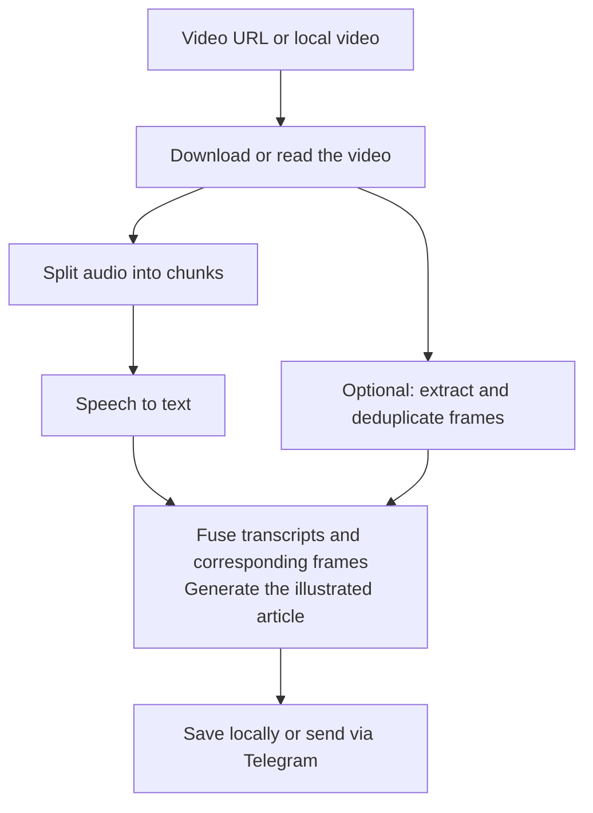

#  video2interleaved-imagetext

[English](README.md) | [简体中文](chinese_readme.md)

## Overview

video2interleaved-imagetext turns Bilibili, YouTube, and local videos into readable articles with interleaved text and images, aiming to turn a 60-minute video into about 10 minutes of reading. A speech-to-text model transcribes the audio, and a multimodal model organizes headings, paragraphs, and explanations while preserving useful ideas, examples, and reasoning. Relevant slide information supplements the text, and original screenshots appear only when a chart or visual relationship needs them. Supports the command line and a Telegram Bot.

## Workflow

Adjacent audio chunks overlap. Once all chunks have been transcribed, the program processes them in order, joins unfinished sentences, removes duplication, and adds headings and lists by topic. When images are enabled, local FFmpeg extracts frames; differences within the slide region define groups, and the last frame of each group is retained. The model receives the transcript and corresponding screenshots, supplements useful information, and includes original images only when necessary. Recoverable fusion format errors trigger up to five retries after the initial request (six attempts total), using the latest error and response to guide each retry.



## Installation and Configuration

### Dependencies

Requires Python 3.10+, FFmpeg, ffprobe, and Deno. Run the following commands from the project root.

- **Create a virtual environment:**

  ```sh
  python -m venv .venv
  ```

- **Activate the environment:**

  Windows PowerShell:

  ```powershell
  .\.venv\Scripts\Activate.ps1
  ```

  Linux:

  ```bash
  source .venv/bin/activate
  ```

- **Install dependencies:** use `python` and `pip` after activation on either platform.

  ```sh
  pip install -r requirements.txt
  pip install deno
  ```

- **Download and install FFmpeg:**

  On Windows, extract `ffmpeg.exe` and `ffprobe.exe` directly into `.venv\Scripts`:

  ```powershell
  $scripts = (Resolve-Path .\.venv\Scripts).Path
  $archive = Join-Path $scripts 'ffmpeg.zip'
  Invoke-WebRequest 'https://www.gyan.dev/ffmpeg/builds/ffmpeg-release-essentials.zip' -OutFile $archive

  Add-Type -AssemblyName System.IO.Compression.FileSystem
  $zip = [System.IO.Compression.ZipFile]::OpenRead($archive)
  try {
      foreach ($entry in $zip.Entries | Where-Object { $_.FullName -match '/bin/(ffmpeg|ffprobe)\.exe$' }) {
          [System.IO.Compression.ZipFileExtensions]::ExtractToFile($entry, (Join-Path $scripts $entry.Name), $true)
      }
  } finally {
      $zip.Dispose()
  }
  ```

  On Linux, install FFmpeg and ensure `ffmpeg` and `ffprobe` are available in `PATH`. For example, on Ubuntu/Debian:

  ```bash
  sudo apt install ffmpeg
  ```

### Models and Parameters

- **Model setup:** copy `env.example.yaml` to `env.yaml` on first use. Set `api.api_key`, or supply the key through the variable named by `api.api_key_env` (default: `DASHSCOPE_API_KEY`). Set `api.base_url` to your provider's OpenAI-compatible endpoint. The defaults are `qwen-audio-3.1-asr-flash` for transcription and `qwen3.8-flash` for text and image fusion.

  ```yaml
  api:
    api_key_env: DASHSCOPE_API_KEY
    base_url: https://dashscope.aliyuncs.com/compatible-mode/v1
  models:
    asr: qwen-audio-3.1-asr-flash
    fusion: qwen3.8-flash
  ```

- **Processing parameters:** configure processing with the following settings.

  | `processing` parameter | Default | Description |
  | --- | --- | --- |
  | `audio_chunk_seconds` | `120` | Base audio chunk duration in seconds |
  | `audio_overlap_seconds` | `4` | Overlap in seconds between adjacent chunks, to join boundary sentences |
  | `audio_bitrate_kbps` | `32` | Audio chunk MP3 bitrate in kbps |
  | `frame_interval_seconds` | `15` | Base frame sampling interval in seconds; may increase for long videos |
  | `max_frames` | `120` | Maximum candidate frame count before local filtering |
  | `frame_region_detection` | `true` | Automatically detect the slide comparison region using representative frames |
  | `frame_compare_region` | Unset | Manual comparison region `[left, top, right, bottom]`, normalized to 0-1; overrides automatic detection |
  | `frame_similarity_threshold` | `3.0` | Start a new group when the mean regional grayscale difference reaches this percentage; `0` retains all candidates |
  | `vision_batch_size` | `8` | Maximum corresponding screenshots per segment fusion request |
  | `default_images` | `true` | Extract frames and provide images by default |
  | `output_language` | `zh` | Article output language |
  | `keep_fusion_responses` | `false` | Keep fusion model responses and validation results after success |

## Usage

### Command Line

Run after activating the virtual environment:

```sh
# Process a Bilibili or YouTube URL
python -m video2interleaved.cli --url "VIDEO_URL"

# Use audio only, or process a local video
python -m video2interleaved.cli --url "VIDEO_URL" --no-images
python -m video2interleaved.cli --file "lecture.mp4" --images
```

- `--images / --no-images`: enable or disable frame extraction.
- `--config`: specify the configuration file.
- `--output-dir`: specify the output directory.
- `--cookies-from-browser edge`: use browser cookies; also supports chrome, firefox, and brave.
- `--help`: show all options.

### Telegram Bot

Create a Bot with BotFather. Set `telegram.bot_token` in `env.yaml`, or use the environment variable named by `telegram.bot_token_env` (default: `TELEGRAM_BOT_TOKEN`). Set permitted Chat IDs in `telegram.allowed_chat_ids`; an empty list allows all users. `telegram.poll_timeout_seconds` controls the long-poll timeout, defaulting to 30 seconds. Start after activating the environment:

```sh
python -m video2interleaved.cli --bot
```

Send a video URL directly, or use `/process VIDEO_URL --images` or `/process VIDEO_URL --no-images`. Jobs are queued, then delivered as formatted Markdown text and images in article order; headings, lists, tables, code, and formulas use Telegram Rich Markdown. The original Markdown file is also sent for download. Use `/status` to check tasks and `/id` to get your Chat ID.

### Persistent Operation on Linux

Install tmux, then run from the project directory on the server:

```bash
tmux new -s video2interleaved
source .venv/bin/activate
python -m video2interleaved.cli --bot
```

## Output Files

Each job creates a separate `output/<source-hash>_<timestamp>/` directory containing `article.md` (illustrated article), `article.json` (content blocks), `audio_raw.md` (raw transcript), `audio.md` (reconciled transcript), `frame_selection.json` (frame selection), and `metadata.json` (job information). When images are enabled, keep `frames/` alongside the article when sharing. `keep_fusion_responses` controls whether model replies are retained. Downloaded videos and audio chunks are cleaned up after success; intermediates remain after failure for debugging.

## New Feature Exploration

Building on this project, we also explore standalone functions such as video downloading and speech-to-text:

- **Video downloading:** use yt-dlp from the project dependencies to download Bilibili or YouTube videos, or reuse [download_video](video2interleaved/media.py).

  ```sh
  python -m yt_dlp --no-playlist -f "bv*+ba/b" -o "output/%(title)s.%(ext)s" "VIDEO_URL"
  ```

- **Speech-to-text:** provide a config file and URL to [test_audio.py](tests/test_audio.py) to download the video, split the audio, and run ASR. The raw transcript is saved to `.tmp/audio/<hash_timestamp>/audio_raw.md`.

  ```sh
  python -B tests/test_audio.py --config env.yaml --url "VIDEO_URL"
  ```
