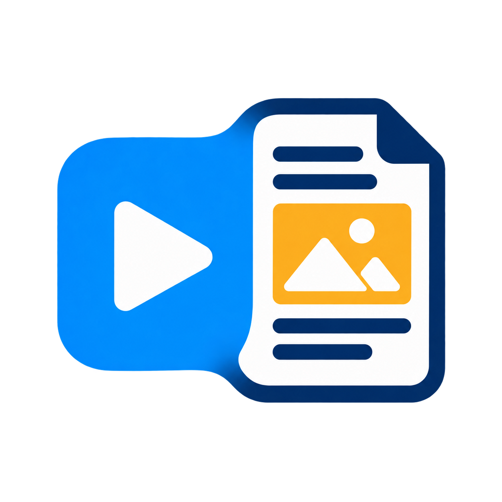
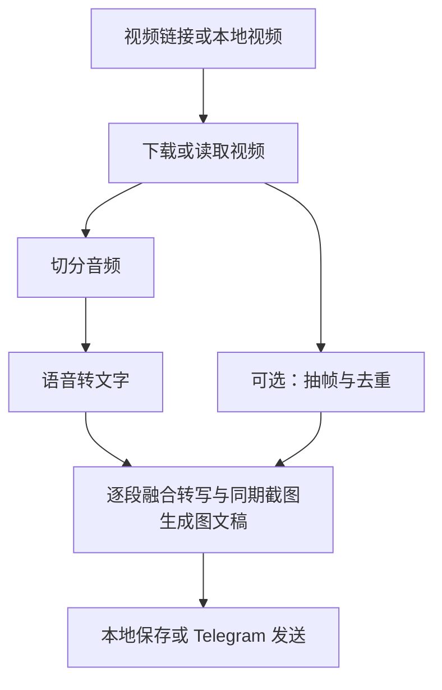

#  video2interleaved-imagetext

[English](README.md) | [简体中文](chinese_readme.md)

## 项目介绍

video2interleaved-imagetext 将 B 站、YouTube 或本地视频整理成文字与图片交错的可读文稿，帮助读者把 60 分钟的视频观看时间缩短为约 10 分钟的文稿阅读，更快获取和回顾信息。项目使用语音转文字模型转写语音，再由多模态模型整理标题、段落与逻辑，保留有助理解的观点、示例和推导，并补充 PPT 中的相关信息；只有文字难以说明的图表或视觉关系才引用原始截图。支持命令行处理和 Telegram Bot。

## 处理流程

相邻音频段保留重叠，全部转写完成后按顺序整理正文，接续跨段未完句并去除重复，同时按主题添加小标题和分点。开启图片时，由本地 FFmpeg 抽帧，通过 PPT 区域内的画面差异分组并保留每组最后一张，再将同期截图与转写交给模型；模型补充有用信息，并仅在确有必要时将原图插入文稿。可恢复的融合格式错误最多重试 5 次（含首次请求共最多 6 次），每次重试提供最近一次错误和回复。



## 安装与配置

### 依赖安装

需要 Python 3.10+、FFmpeg、ffprobe 和 Deno。以下操作在项目根目录执行。

- **创建虚拟环境**：

  ```sh
  python -m venv .venv
  ```

- **激活环境**：

  Windows PowerShell：

  ```powershell
  .\.venv\Scripts\Activate.ps1
  ```

  Linux：

  ```bash
  source .venv/bin/activate
  ```

- **安装依赖**：激活后统一使用 `python` 和 `pip`。

  ```sh
  pip install -r requirements.txt
  pip install deno
  ```

- **下载与安装 FFmpeg**：

  Windows 将 `ffmpeg.exe` 和 `ffprobe.exe` 直接解压到 `.venv\Scripts`：

  ```powershell
  $scripts = (Resolve-Path .\.venv\Scripts).Path
  $archive = Join-Path $scripts 'ffmpeg.zip'
  Invoke-WebRequest 'https://www.gyan.dev/ffmpeg/builds/ffmpeg-release-essentials.zip' -OutFile $archive

  Add-Type -AssemblyName System.IO.Compression.FileSystem
  $zip = [System.IO.Compression.ZipFile]::OpenRead($archive)
  try {
      foreach ($entry in $zip.Entries | Where-Object { $_.FullName -match '/bin/(ffmpeg|ffprobe)\.exe$' }) {
          [System.IO.Compression.ZipFileExtensions]::ExtractToFile($entry, (Join-Path $scripts $entry.Name), $true)
      }
  } finally {
      $zip.Dispose()
  }
  ```

  Linux 安装后确保 `ffmpeg` 和 `ffprobe` 可从 `PATH` 找到，例如 Ubuntu/Debian：

  ```bash
  sudo apt install ffmpeg
  ```

### 模型与参数

- **模型使用**：首次使用时复制 `env.example.yaml` 为 `env.yaml`，填写 `api.api_key`，或按 `api.api_key_env` 指定的变量名设置密钥（默认 `DASHSCOPE_API_KEY`）；`api.base_url` 填写所用平台的 OpenAI 兼容接口地址。默认使用 `qwen-audio-3.1-asr-flash` 转写语音，使用 `qwen3.8-flash` 融合文字与截图。

  ```yaml
  api:
    api_key_env: DASHSCOPE_API_KEY
    base_url: https://dashscope.aliyuncs.com/compatible-mode/v1
  models:
    asr: qwen-audio-3.1-asr-flash
    fusion: qwen3.8-flash
  ```

- **processing 参数**：处理参数配置如下。

  | `processing` 参数 | 默认值 | 说明 |
  | --- | --- | --- |
  | `audio_chunk_seconds` | `120` | 音频分段的基础时长，单位为秒 |
  | `audio_overlap_seconds` | `4` | 相邻音频段的重叠时长，帮助接续边界句 |
  | `audio_bitrate_kbps` | `32` | 音频切片的 MP3 码率 |
  | `frame_interval_seconds` | `15` | 抽帧基础间隔；长视频可能增大间隔 |
  | `max_frames` | `120` | 本地筛选前参与处理的最大候选帧数 |
  | `frame_region_detection` | `true` | 是否通过代表性截图自动判断 PPT 比较区域 |
  | `frame_compare_region` | 未设置 | 手动比较区域 `[左, 上, 右, 下]`，坐标为 0～1；优先于自动判断 |
  | `frame_similarity_threshold` | `3.0` | 区域内平均灰度差达到此百分比时开启新组；`0` 表示保留全部候选帧 |
  | `vision_batch_size` | `8` | 每段融合请求最多提供的同期截图数 |
  | `default_images` | `true` | 默认是否抽帧并向模型提供图片 |
  | `output_language` | `zh` | 文章输出语言 |
  | `keep_fusion_responses` | `false` | 成功后是否保留融合模型回复和校验结果 |

## 使用方式

### 命令行

激活虚拟环境后运行：

```sh
# 处理 B 站或 YouTube 链接
python -m video2interleaved.cli --url "视频链接"

# 只使用语音，或处理本地视频
python -m video2interleaved.cli --url "视频链接" --no-images
python -m video2interleaved.cli --file "lecture.mp4" --images
```

- `--images / --no-images`：控制是否抽帧。
- `--config`：指定配置文件。
- `--output-dir`：指定输出目录。
- `--cookies-from-browser edge`：读取浏览器登录态，也支持 chrome、firefox、brave。
- `--help`：查看完整选项。

### Telegram Bot

通过 BotFather 创建 Bot，将 Token 填入 `env.yaml` 的 `telegram.bot_token`，或设置 `telegram.bot_token_env` 指定的环境变量（默认 `TELEGRAM_BOT_TOKEN`）。`telegram.allowed_chat_ids` 填允许使用的 Chat ID，留空表示不限制；`telegram.poll_timeout_seconds` 为长轮询超时，默认 30 秒。激活环境后启动：

```sh
python -m video2interleaved.cli --bot
```

向 Bot 直接发送视频链接，或发送 `/process 视频链接 --images`、`/process 视频链接 --no-images`。任务排队处理，完成后按原文顺序发送排版后的正文和图片；标题、列表、表格、代码与公式通过 Telegram Rich Markdown 显示，并附上原始 Markdown 文件供下载；`/status` 查看任务状态，`/id` 获取自己的 Chat ID。

### Linux 常驻运行

安装 tmux 后，在服务器项目目录中运行：

```bash
tmux new -s video2interleaved
source .venv/bin/activate
python -m video2interleaved.cli --bot
```

## 输出文件

每次任务保存到独立的 `output/<来源哈希>_<时间>/`，包含 `article.md`（图文稿）、`article.json`（图文块）、`audio_raw.md`（原始转写）、`audio.md`（整理后转写）、`frame_selection.json`（选图记录）和 `metadata.json`（任务信息）。启用图片时保留 `frames/`，分享文稿时一并携带；`keep_fusion_responses` 控制是否保留模型回复。成功后清理下载视频与音频切片，失败时保留中间文件供排错。

## 新功能探索

我们从该项目也探索了一些子功能，如视频下载、语音转文本等，可单独使用：

- **视频下载**：使用项目依赖中的 yt-dlp 下载 B 站或 YouTube 视频；也可复用 [download_video](video2interleaved/media.py)。

  ```sh
  python -m yt_dlp --no-playlist -f "bv*+ba/b" -o "output/%(title)s.%(ext)s" "视频链接"
  ```

- **语音转文本**：给定配置与 URL，运行 [test_audio.py](tests/test_audio.py)，完成视频下载、音频切片与 ASR 转写；原始文本保存到 `.tmp/audio/<哈希_时间>/audio_raw.md`。

  ```sh
  python -B tests/test_audio.py --config env.yaml --url "视频链接"
  ```
